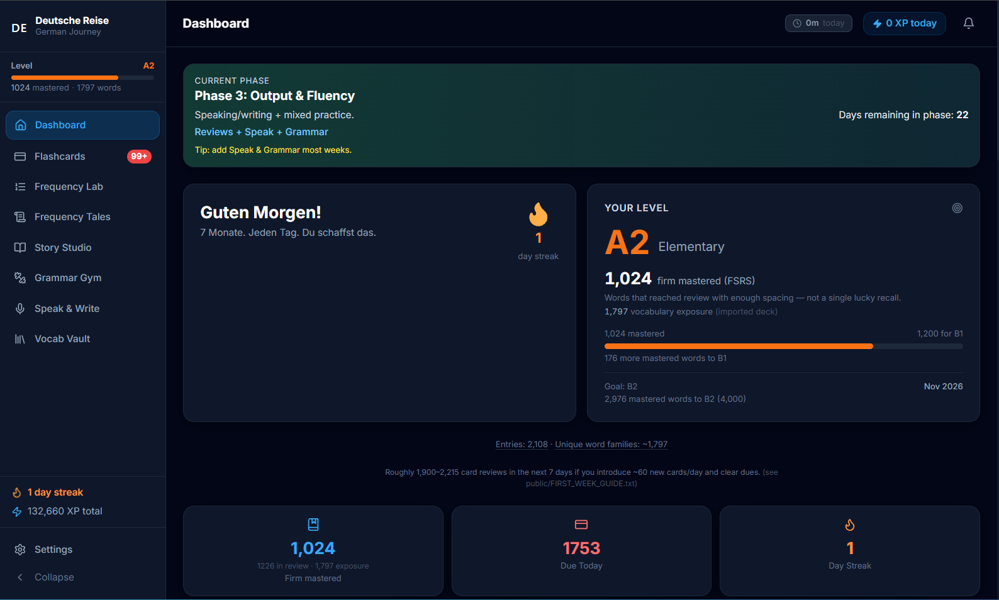
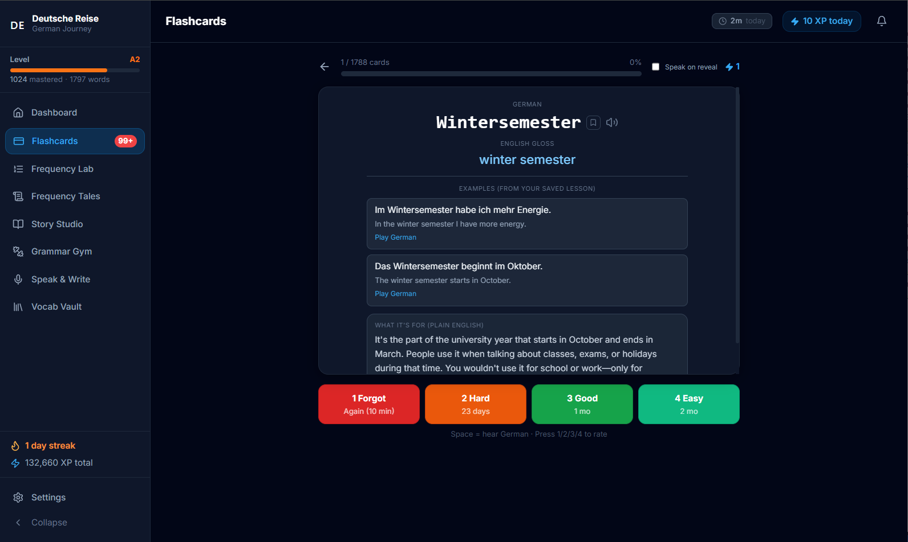
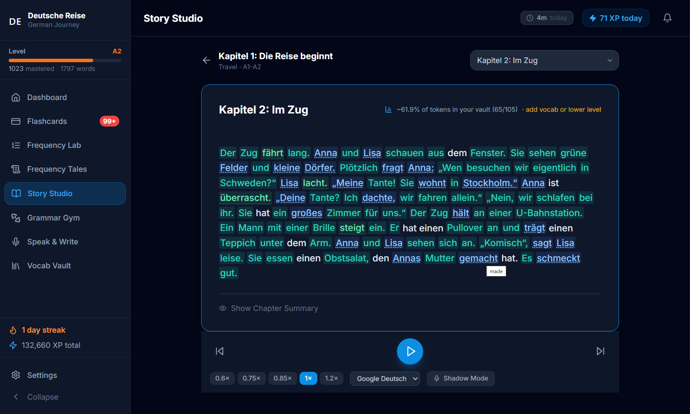
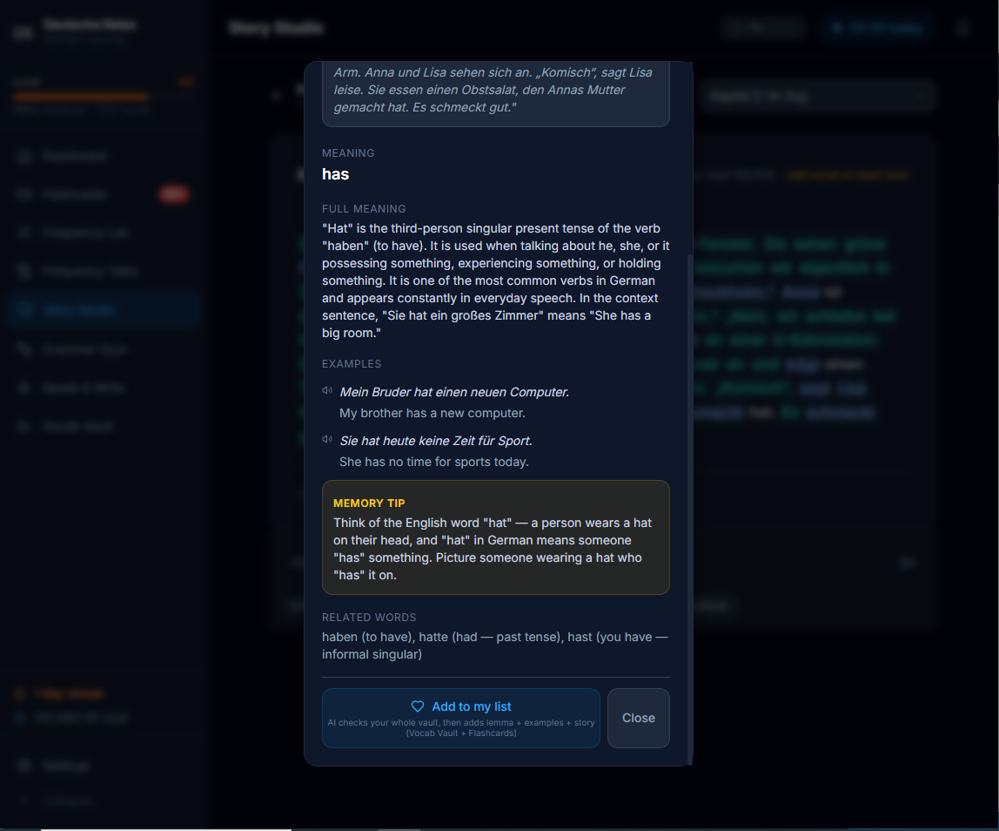
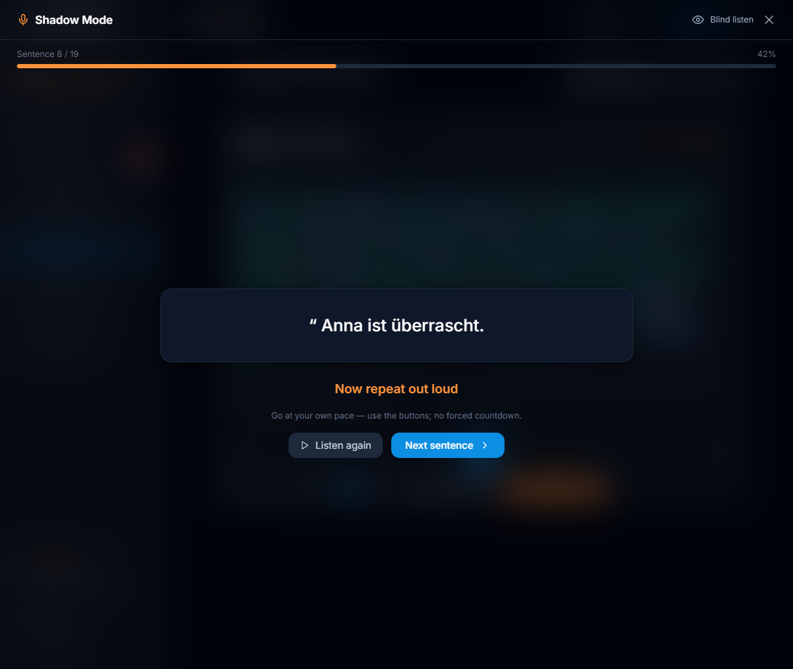
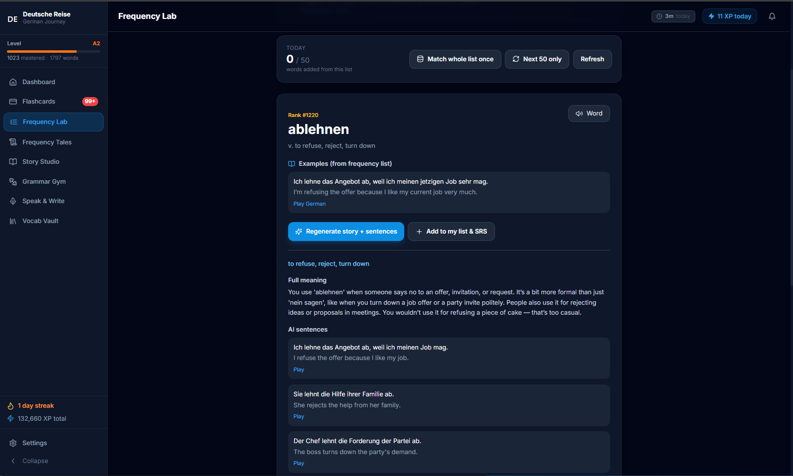
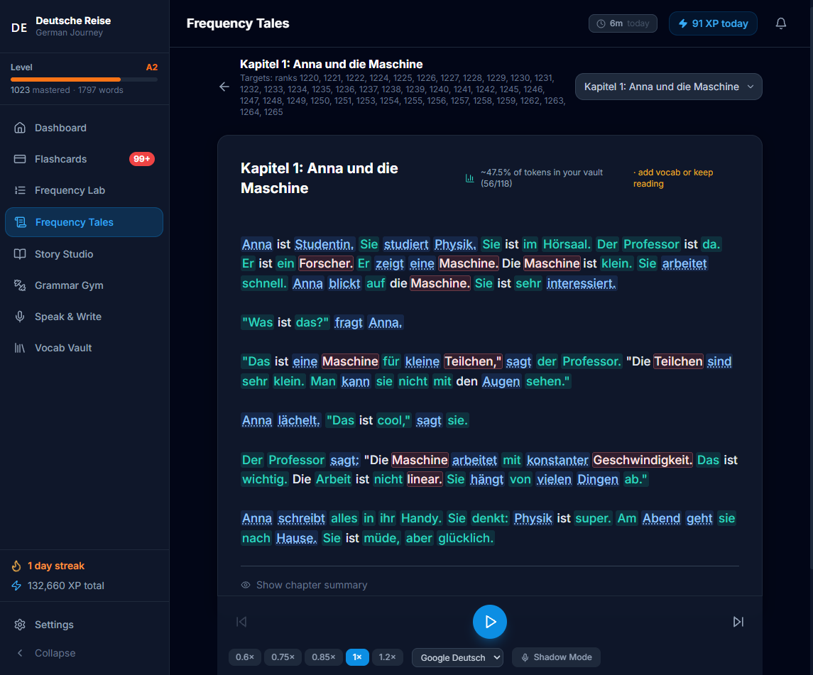
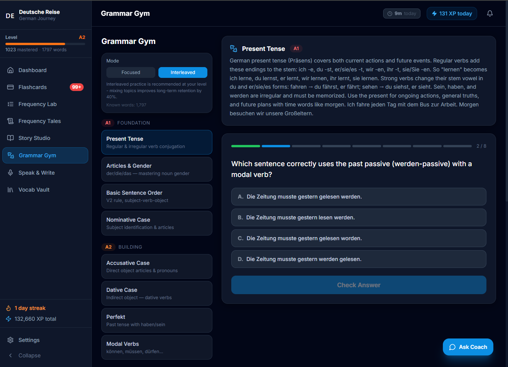
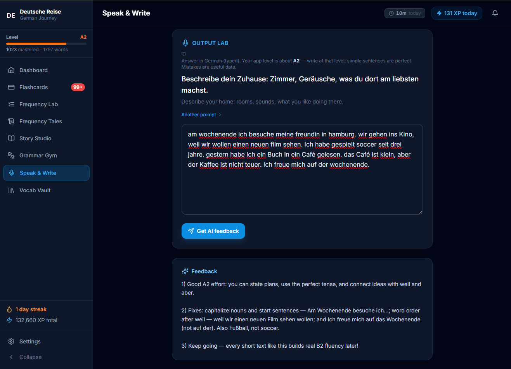
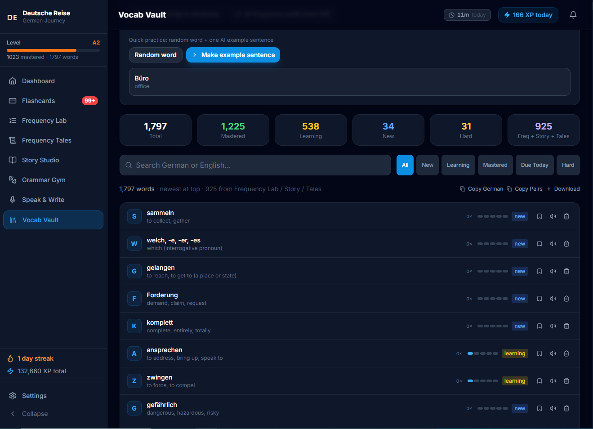

# Deutsche Reise

<!-- Screenshot width convention for this file: 720px. Change the width="720" value below to resize all of them. -->

A German learning app I built for myself, on top of spaced repetition and AI-generated reading material built from words I already know.

<p align="center">
  
  <br>
  <em>The dashboard: streak, level, daily plan, and a study-trail heatmap.</em>
</p>

## Why I built it

I was learning German on Duolingo and could recognise vocabulary, but I couldn't turn it into active vocabulary: actually understanding and speaking it. Spending more time on Duolingo or watching German YouTube didn't fix that. So I built my own app and kept adding whatever I wanted to try next.

## Features

**Flashcards, built on FSRS.** Duolingo never made sure I could actually recall and revise every word I'd learned. I read about FSRS (the scheduler Anki uses) and built my flashcards on it instead of a simpler fixed-interval system. The worst outcome in language learning is forgetting a word you already spent time on, and FSRS is specifically designed to minimise that.

<p align="center">
  
  <br>
  <em>A review in progress, with interval previews on the rating buttons.</em>
</p>

**Story Studio.** German stories on YouTube, even "beginner" ones, kept using words I didn't know, so I couldn't follow them or stay consistent. Story Studio asks the AI to write a short story using as many words as possible that are already in my vocabulary. That makes it readable, and it moves words from passive recognition to active use.

<p align="center">
  
  <br>
  <em>A story generated mostly from words I already know.</em>
</p>

I added tap-a-word-for-its-meaning so I understand new words in context, not just as dictionary definitions.

<p align="center">
  
  <br>
  <em>Tapping a word shows its meaning in context and lets me save it.</em>
</p>

I also added shadowing, because what I'd read said it specifically helps pronunciation and speaking, not just comprehension.

<p align="center">
  
  <br>
  <em>Listen, then repeat the sentence out loud.</em>
</p>

**Frequency Lab.** The common advice (Reddit, language-learning forums) is to learn the most frequent words first, and the logic behind it is straightforward: a handful of words cover a huge share of everyday text. I found a German word-frequency list and loaded it into the app. Each frequency word gets a generated example and a plain English definition, then goes straight into the FSRS deck.

<p align="center">
  
  <br>
  <em>A frequency-ranked word with an example sentence and a button to add it to my deck.</em>
</p>

**Frequency Tales.** Learning frequency words in isolation was boring, so I reused the Story Studio logic: the AI writes a story from words I already know plus a handful of new frequency-ranked ones, so each new word shows up surrounded by dozens of words I already understand.

<p align="center">
  
  <br>
  <em>A generated story; red words are new, teal words are ones I already know.</em>
</p>

**Grammar Gym.** Learning German quickly needs actual grammar practice, not just vocabulary, so there's a set of grammar exercises by topic, plus an "Ask Coach" option for explanations.

<p align="center">
  
  <br>
  <em>Targeted grammar exercises by topic.</em>
</p>

**Speak & Write.** Everything above is input. I needed output too, so I write something in German and the AI checks it and tells me what's wrong.

<p align="center">
  
  <br>
  <em>I write in German, the AI points out what's wrong.</em>
</p>

**Vocab Vault.**

<p align="center">
  
  <br>
  <em>Every word I've saved, with filters and progress.</em>
</p>

**Study timer.** A per-section timer that pauses when I go idle, so the time I see reflects actual study, not an open tab.

## How it works

Everything runs in the browser. There's no backend server: the "database" is IndexedDB, and the only outside calls are to the DeepSeek API (for anything AI-generated) and, optionally, Supabase (for cloud backup of your IndexedDB data).

```
Browser
 ├─ IndexedDB (words, FSRS cards, stories, grammar sessions, daily sessions)
 ├─ FSRS, ts-fsrs (schedules every flashcard review)
 ├─ DeepSeek API (stories, glosses, grammar exercises, writing feedback)
 └─ Supabase, optional (cloud backup of your IndexedDB export)
```

Vocabulary import, Story Studio, and Frequency Tales all share the same word-matching and story-generation logic. Frequency Tales is really Story Studio pointed at a queue of frequency-ranked target words instead of a free topic.

## Tech stack

React 18 + Vite · IndexedDB (via `idb`) · `ts-fsrs` for spaced repetition · DeepSeek API for generation and feedback · Supabase (optional) for backup · Tailwind CSS.

## Run it locally

```bash
git clone https://github.com/Maryam-Nisar-Ahmad/deutsche-reise.git
cd deutsche-reise
npm install
npm run build:baseline   # or just `npm run build`, which runs this too
npm run dev
```

Open `http://localhost:3000`. In Settings, add your own DeepSeek API key (stored only in your browser's localStorage) to use the AI features. The app runs without one, just without AI-generated content.

The repo ships a small sample vocabulary list (`words.txt`, ~50 common words) in place of my real one, so "Import bundled baseline" in Vocab Vault has something to import. The Daily Coach feature similarly falls back to a small public sample of language-acquisition research (`src/data/research.sample.txt`) instead of a longer private document.

## Hardest part / what I learned

Story Studio and the shadowing setup took the most work: getting the AI to reliably write a coherent story mostly using words I already know, and building the listen-then-repeat audio flow around it. Once that was working, I reused almost all of that logic to build Frequency Tales.

## Known limits

- Single-user, browser-local by design. There's no server-side account system, just an optional Supabase backup of your local data.
- The DeepSeek API key lives in `localStorage`, which is fine for a personal tool but not something I'd ship for other people without changing it.
- No hosted demo: it's meant to be run locally with your own API key.
- The 5,009-word frequency list came from a shared Anki deck. I don't know the original source and will remove it if the owner asks. It is not covered by the MIT license.

## License

MIT (see [LICENSE](LICENSE)).
